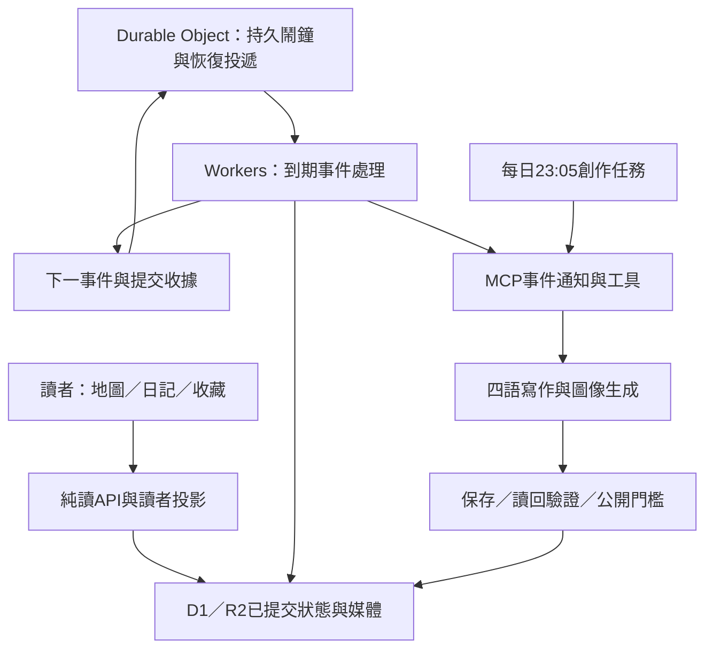

# 架構與工程案例

本文件供作品集閱讀。正式操作仍以完整工作區的交接及架構文件為準。

## 系統分工

正常行程由持久單次鬧鐘接續，另有30分鐘健康檢查；每日23:05保留AI創作任務。網站state讀取不補算世界，舊五時段Cron已停用。圖示為邏輯資料流，D1、R2及外部服務不具有跨服務原子交易。

## 案例一：事件已提交，為何行程仍卡住？

**問題。** 正式診斷顯示世界已寫入D1，但請求仍等待舊快照清理，最終遭外層逾時取消；全域Promise佇列也有取消後阻擋後續請求的證據。

**處理。** 將提交後的清理、通知及非關鍵備份移至背景執行，保留關鍵事前備份的等待；修正跨請求阻擋及過期租約處理，並限制外部請求與恢復鬧鐘的等待時間。

**驗證。** 人工同步恢復後，下一個原定自然事件自行成功，保存新的計畫版本與下一事件。這支持修復有效，但不能直接推論長期可用率。

來源：[交易與持久化](../lib/runtime.ts)、[事件處理](../bridge/event-runtime.mjs)、[外部事件時鐘](../external-timer/event-worker.mjs)。

## 案例二：AI通知成功，不等於圖片可以公開

**問題。** 生成是非同步工作，可能提早完成、晚到或重送。若以通知200或R2檔案存在作為完成條件，就可能提前公開尚未發生的體驗，或重複生成。

**處理。** 以同一抽選身份追蹤參考、成品保存、驗證及公開狀態。選定後準備圖片，活動完成才開放讀者取得；晚到圖片仍核對同一完成門檻。AI通知已受理後，不因缺圖而自動反覆喚起。

**驗證。** 測試涵蓋完成前的列表及圖片存取、保存重試、晚到成品與防重；正式人工恢復另核對保存狀態與公開結果。自然生成的長期可靠度仍持續觀察。

來源：[生命週期規格](../SKETCH_LIFECYCLE.md)、[共同實作](../bridge/sketch-lifecycle.mjs)、[作畫資料包](../bridge/sketch-work.mjs)。

## 案例三：將來源403定位到實際請求

**問題。** 多個景點連續無法取得參考圖。只看到生圖失敗，難以分辨來源API、圖片下載或生成平台出了問題。

**處理。** 保存實際失敗URL與API／圖片階段，再比較Cloudflare上同一URL有無描述性User-Agent的回應，確認缺少識別是此次403的原因，並統一景點與餐點的Wikimedia識別設定。

**驗證。** 同URL由403轉為200；修正函式在隔離Cloudflare環境成功取得四個失敗景點圖片，正式兩筆待處理工作亦完成取圖與通知。這證明參考取得修正，並不等於後續每次生圖都成功。

來源：[景點參考](../bridge/footprint-reference.mjs)、[共用參考下載](../bridge/collection-reference.mjs)。

## 案例四：降低手機更新負擔

**處理。** 每秒位置呈現不再重建整頁，未變動的路線、日記與圖片保留；背景分頁停止讀取state，書頁按可用高度排版，圖片提供輕量預覽。

**驗證。** 五種尺寸共15個隔離畫面檢查通過；同一張圖片預覽約90 KB降至36 KB。沒有以此推論全站載入時間或真實使用者體感的改善幅度。

來源：[旅程介面](../public/app.js)、[書頁排版](../public/dialog-paging.js)、[圖片預覽](../bridge/reader-image.mjs)。

## 驗證範圍

引用基準為2026-11-08正式139：202項站內、191項共用與3項工具測試、型別檢查及建置通過。包含狀態與權限規則，以及Miniflare D1／R2隔離儲存案例。正式自然事件、人工恢復與隔離fixture的證據分開記錄。

完整工作區證據入口：`data/event-stall-20261102/FIX.md`、`data/wiki-reference-audit-20261108/REPORT.md`、`data/mobile-performance-20261108/REPORT.md`。這些私人診斷資料未隨本倉庫上傳，不作為招聘者可直接存取的公開附件。
